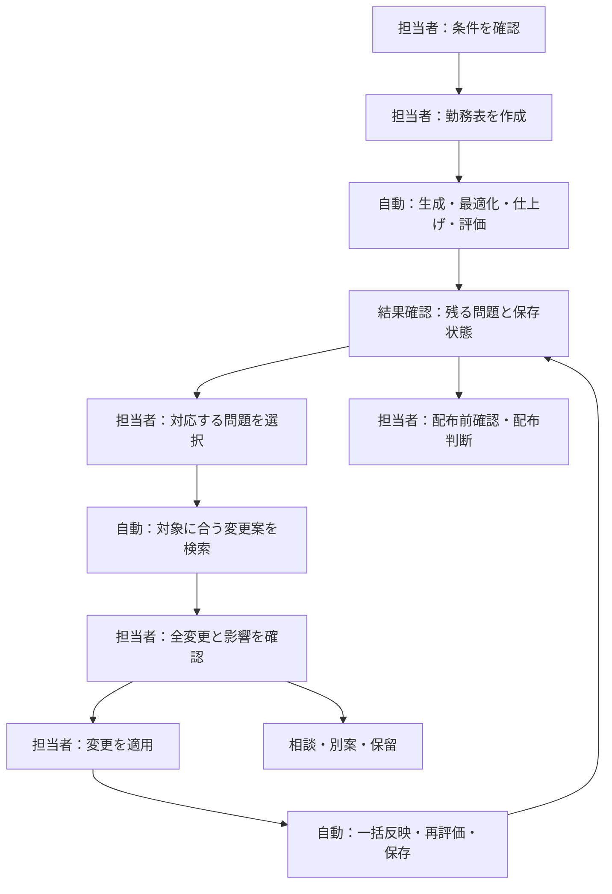

# MAGI オペレーター向けUX（思考誘導・指1本・スマホ特化）

**対象ユーザー**: 人事課マネージャー／リーダーの「判断」はできるが、ITは**中学生レベル**のオペレーター。
**ねらい**: 専門用語ゼロ・**画面が次の一手を教える（思考誘導）**・**指1本**で最後まで進める。

> 本書は画面・オブジェクト・操作手順の**書き直し（リライト）**。実装時は本書の文言・手順をそのまま採用する。
> 既存の技術仕様は [`screen_spec.md`](screen_spec.md)。

---

## 1. 設計の5原則（迷わせない）

1. **一画面・一目的・一行動**: どの画面も「いまここで何をするか」を上に1行、**大きな主ボタンは下にひとつ**だけ。
2. **専門用語を使わない**: §2 の言い換え表に従う。数字は必ず**言葉で意味**を添える（「78%（でき具合）」）。
3. **指1本・下に集約**: 主操作は常に画面**下端（親指ゾーン）**。1タップで進む。打ち込みより**選ぶ**。
4. **失敗が怖くない**: すべて**やり直せる（元に戻す）**・**確認してから**・**自動保存**。消える操作は赤＋確認。
5. **状態で導く**: いまの状態に応じて、画面が**「次にやること」**を自動で出す（§3）。

---

## 2. 言葉の言い換え（IT用語 → ふつうの言葉）

| 画面に出していた言葉 | 書き直し（オペレーター向け） |
|---|---|
| 最適化する / RunMAGI | **勤務表をつくる** / **いい感じに整える** |
| 設定ミス・設定の壁（個人の上限0について） | **入れないシフトの指定（個人の上限0）**・**例外として上限を緩める**（上限0は意図した制限。上限0に載った希望は「残るのは要調整です」、2026-09-28） |
| 簡易作成 / 初期解生成 | **下書きをつくる**（現在は初期解生成の導線に使用・3.409.3） |
| 配布可 | **配れます**（3.678.0 から上部の札は「必須違反 0・配布前の確認」＝配れるとは言い切らない） |
| 要確認 | **もう少し** |
| 未計算 | **まだ作っていません** |
| 実行中 / 最適化中 | **コンピューターが組んでいます** |
| 必須違反 / HARD | **必須違反**（例：夜勤の翌日に早番）※3.133.0 で「守れていない約束」から凡例に合わせて統一 |
| 調整 / SOFT | **要調整**（この案は未実装。実装では凡例に合わせ「要調整」に統一） |
| 人員不足 / covU | **人員不足**（族名のまま。「人手不足」は使わない＝2026-09-27 利用者決定） |
| スタッフの希望 / pref | **希望と違う勤務**（族名。2026-09-27 利用者決定） |
| 禁止の並び / c3n | **禁止の並び**（族名のまま。「禁止連続」は CSV 種別タグだけ） |
| 連続パターン / c3 | **勤務の並びのルール** |
| 個人別回数 / range | **ひとりの回数の上限・下限** |
| 反復 / iter/s | **（画面に出さない）** |
| 満足度 | **でき具合（0〜100%）**（3.480.0で「できあがり度」から改称。UX改善/ゲーム要素廃止の一環で、フェーズ名バッジも「狩猟」→「未完成」へ改称済み。3.657.0 でバッジは見出しと同じ「まだ作っていません／必須違反 0／必須違反 N」） |
| 違反チェック | **問題がないか調べる** |
| バックグラウンドで最適化 | **閉じても大丈夫（あとで通知）** |

> 原則: **アルファベットの記号（c3n・covU・ALNS 等）は画面に一切出さない**。出すのは「ふつうの言葉＋例」。

---

## 3. 思考誘導ホーム：いつも「次にやること」を1枚

ホーム画面の一番上に、**大きな「いま、これをしましょう」カード**を置く。今の状態で**文言と主ボタンが自動で変わる**。

| いまの状態 | カードの言葉（思考誘導） | 大ボタン（1つ） | 補助 |
|---|---|---|---|
| データがまだ無い | **「① まず、勤務表のデータを開きましょう」** | **データを開く** | お試しを使う |
| 読み込んだ・まだ作っていない | **「② ボタンひとつで、勤務表を作ります」** | **勤務表をつくる** | 下書きをつくる |
| 作っている最中 | **「いま、コンピューターが組んでいます。あと約 N 分。閉じても大丈夫です」** | **ようすを見る** | やめる |
| できた・必須を満たした | **「③ 必須条件を満たしました。中身を確認して配ってください」**（緑。3.643.0 まで「完成しました。そのまま配れます」＝検査結果と人の確認を分けた） | **印刷・書き出し** | 中身を見る。CSV に保存すると「この内容で勤務表 CSV を保存済みです（HH:mm）」の行が残り、そのあと内容が変わると「HH:mm に保存した勤務表 CSV は、今の内容と違います（配るなら保存し直してください）」に変わる（3.644.0＝保存した内容と今の内容を区別。保存は配布ではない）。相談中があれば「未確認事項 N 件（相談中…）」の行＝見出しも書き出しも変えない（3.645.0） |
| できた・要対応（今すぐ直せる人員不足あり） | **「○月○日が人員不足です」**（黄） | **なおし方を見る** | — |
| 自動作成の直後（3.683.0） | 主カードの上端 2 行＝「勤務表の作成が終わりました」（前のままにしたときは「再作成しましたが、前の勤務表のほうが良かったため前のままです」）と「次に確認する問題：{名}さん {見出し}」（主カードと同じ対象）、文字のリンク［ほかの問題を見る］。作成結果の別カードは廃止 |
| できた・要対応（必須を減らす1手あり） | **「必須違反 N件 のうち N件（族：場所）を減らす手があります」**（3.682.0。旧「必須違反が N件 残っています。直す手があります」）（黄）＋本文に手の内容、注記に効果（必須 a→b・違反の増減・ほか N 案）＝旧「AIの解決提案」カードを統合（3.643.0） | **直す1手を見る** | **この変更を適用**＝この場で当てる（注記の末尾に「適用したあとでも元に戻せます。」） |
| できた・要対応（1手を探している間） | **「…直し方を探しています…」**（黄） | （出さない） | — |
| できた・要対応（1手なし・S6 の背景試算が例外で緩める上限0の組を見つけた） | **「氏名 10/8〜10/9の禁止の並び（必須 5件中 1件）は、個人の上限0を例外で緩めると解消できる見込みです」**＋本文「希望を残したまま、設定と勤務表を手順で変えられます」＋注記「残りの必須違反 N件はそのまま残ります」（黄） | **緩める候補を見る** | ぶつかっている希望を見る（関わる希望があるとき） |
| できた・要対応（1手なし・S6 の背景試算中） | **「必須違反が N件 残っています」**＋行「希望を変えずに、個人の上限0を例外で緩める方法を調べています…」［やめる］（黄。**この間は「下限の見込み」と言わない**） | 下の WISH／問題を見る と同じ | 同じ |
| できた・下限の見込み（1手なし・S6 が組なしで終わった・長く改善しない必須・希望が関わる） | **「今の希望とルールの組み合わせでは、必須違反 N件 が下限の見込みです」**（黄） | **ぶつかっている希望を見る** | このまま書き出す |
| できた・要対応（関わる希望あり＝必須に関わる希望か、人員不足の日に別の勤務の希望） | **「…希望とルールがぶつかっています」**（黄） | **ぶつかっている希望を見る** | — |
| できた・要対応（それ以外） | **「必須違反が N件 残っています」**（黄） | **問題を見る** | — |
| 直せない問題が残る（人員不足の日に別の勤務の希望がある） | **「いまの希望のままでは、ここは埋められません」**（赤） | **ぶつかっている希望を見る** | データを見直す |
| 直せない問題が残る | **「このデータでは、ここは埋められません」**（赤・理由つき） | **データを見直す** | そのまま配る |

- **常に主ボタンは1つだけ**を大きく。迷いを作らない。
- 勤務表タブの上部「必須 N ▼」→ 必須違反の一覧（1 件 1 行、希望どうしのぶつかりは「希望のまま」札で後ろ）→ 行を押すとそのセルへ移ってセルシートを開く（`docs/screen_spec.md`）。
- 「勤務表をつくる／再作成する」は、何度つくっても残る項目か、再作成すると外れる手置きがあるときだけ、先に「つくる前の確認」のシートを 1 度出す（［先にデータを直す］／［このままつくる］＝1 タップ。同じデータでは再び止めない。2026-09-28）。
- 要対応の行は上から順に判定する（3.612.0 思考誘導 S0/S4＝「足りる？→1手ある？→上限0を例外で緩めれば解ける？→希望が関わる？」）。「直す手」は必須を減らす手だけ。
  **主ボタンの優先順位（2026-09-27 利用者決定、`OperatorNextActionCard` の判定順）**: 実行中 → 未作成 → 完成 → 充足不可 → 今すぐ直せる不足 → 1手あり → 1手探索中 →
  **S6 の組あり（RELAX）** → **S6 探索中は進捗の行が主で、S5 は補助** → 下限の見込み（FLOOR） → 関わる希望（WISH＝S5 が主になるのは S6 が組なしで終わった後だけ） → 問題を見る。
  S6 は自動で始まる（手動の開始ボタンは無い＝Q7）。S6 が「組なし」で終わったことは進捗の行が消えることで分かる（「候補なし」の段は出さない）。
  「ぶつかっている希望を見る」は関わる希望を名前・日付・理由つきで並べる（押すとそのセルを開く、S3）。希望どうしの衝突に入る行には札「希望のまま」（計算では消せない）。
  主ボタンには最初の対象を添える（例「ぶつかっている希望を見る（アリフ 10/8）」「直す1手を見る（氏名 日）」「なおし方を見る（10/8）」。押した先は同じ、対象が無ければ元の文言）。
  各行の「希望を外したら？」で 1 行ずつ試算し、結果が出た行は「希望を外して再作成（元に戻せます）」（赤字・元に戻す 1 回で希望と勤務表が戻る）で確定できる（S5、`docs/s5_wish_trial.md`）。
  確定の結果は盤面か希望が変わるまでカードに 1 行残る。
- カードの下に「いまの出来ぐあい」を**言葉つきの数字**で（例：「人員不足の日：1日 / でき具合：78%」）。

---

## 3.5 自動作成と半自動修正の分担（3.672.0、2026-10-14 利用者指示）

どこまで自動で進み、どこで担当者が判断するかを分ける。担当者が判断するのは「作成の前の条件」「対応する問題の選択」「全変更と影響の確認と適用」「配布の判断」の 4 か所だけで、自動は途中で一手ごとの確認を求めない。

| 段 | 画面（実装） | 守ること |
|---|---|---|
| 作成の前 | 「勤務表を作成する」シート（`PreRunCheckSheet`・`preRunPlanLines`）＝対象期間・職員・登録条件の確認結果・自動で行うこと（生成・最適化・仕上げ・評価）・保持するもの（登録条件と手動固定）・探索時間と仕上げ用の追加枠、［勤務表を作成］［条件を確認する］ | 開始後は一手ごとに確認を求めない。希望・必要人数・固定条件の変更は別の判断 |
| 作成の後 | ホームの「勤務表の作成が終わりました」（`CreationResultCard`・`creationResultLines`）＝必須違反・要調整（族ごとの件数／pt）・保存・次に確認する問題、［この問題の変更案を見る］［ほかの問題を見る］［配布前の確認］ | 作成の完了を配布可能と同じ意味で言わない |
| 半自動の検索 | 集計・日の印・セルのシートの変更案（`FixSearchPanel`・`panelTarget`・`resolvesAtCell`）＝選んだ日付・勤務・問題を保持し、その問題を変える案だけを主一覧に | 別の日の違反だけを減らす案を今回の修正案として出さない |
| 担当者の判断 | 確認の画面（`ChainFixPreviewDialog`）＝今回の目的・職員ごとの全変更・今回の不足の前後・新たな必須違反・希望と回数と前後日への影響・対応する人と時期・必要な相談、［この変更を適用］［相談事項に登録］［別案を見る］［今は変更しない］ | 値は正式な評価から（評価していない値は「未評価」）。相談の登録は連絡・了承の記録ではない |
| 適用の後 | 「変更を反映しました」（`AppliedBanner`・`appliedLines`）＝今回の問題（解消／減少／残存）→期間全体の過不足（日の対象）→全体の必須→新たに生じた問題→人数・保存（保存中・失敗のときだけ）・次にすること、［続けて {記号} の案を見る］か［残っている必須違反を順に見る（Nか所）］（3.682.0）［今回の変更内容を見る］［今回の変更を元に戻す］ | 適用前に勤務表・設定が変わっていれば反映しない（指紋照合）。適用直前に再評価（`FixApplyGate`）し、見ている問題の数が減らない案は当てない（3.674.0）。適用したら残る案は今の勤務表で探し直す |

## 4. 画面の書き直し（各画面：この画面ですること / 見方 / 手順 / 次の一手）

### 4.1 ホーム（変更なし。役割＝司令塔）
- **この画面ですること**: 「次にやること」を確認して、その大ボタンを押すだけ。
- **見方**: 上＝次の一手 / 中＝出来ぐあい（言葉つき）/ 下＝大ボタン。
- **手順**: ①カードを読む → ②下の大ボタンを押す。**それだけ**。

### 4.2 勤務表（見る・直す）
- **この画面ですること**: できた表を見る。直したい所をタップして変える。
- **書き直し**:
  - 上に**「見るだけ」「直す」の2択ボタン**（旧：結果/編集中）。「見るだけ」では押しても変わらない＝**間違って消さない**。
  - 「直す」にすると、マスをタップ→**そのスタッフが入れる勤務だけ**が大きなボタンで出る（選ぶだけ）。
  - 問題のあるマスは**赤いふち**。説明は「この勤務は約束を守れていません（例つき）」。
- **手順（直す）**: ①「直す」を押す → ②赤いマスをタップ → ③出てきた勤務から1つ選ぶ → ④下の「再作成」で全体を整える。
- **次の一手**: 直し終わったら下の**「再作成」**。

### 4.3 直す（旧・編集）
- **この画面ですること**: スタッフの**希望**を入れる／**人手の必要数**を決める。
- **書き直し**:
  - 一覧は**名前＋いつ＋何の希望**を1行で。右に「**入れられる**／**むり（担当外）**」の色タグ。
  - 「**この希望を勤務表に入れる**」大ボタン→**「○件は担当外なので入りません。よいですか？」**と確認→**いつでも元に戻せます**。
  - 制約ルール（並びの禁止など）は**「年に数回だけ・制度が変わった時」**の別ページに分け、毎月は触らせない（誤操作防止）。
- **手順（希望を入れる）**: ①一覧で内容を確認 → ②「勤務表に入れる」 → ③確認に「はい」。

### 4.4 ようす（旧・分析）
- **この画面ですること**: 出来ぐあいを**言葉と色**で確認する。
- **書き直し**:
  - 上に大きく「**でき具合 92%**」と「**人員不足の日：0**」。
  - 下に「気になる点」を**やさしい言葉のリスト**（「金曜が少し手薄です」など）。専門記号は出さない。タップでその日に飛ぶ。
- **手順**: 見るだけ。気になる行をタップ→勤務表のその日へ。

### 4.5 設定
- **この画面ですること**: 計算にかける**時間**・通知・見た目を決める。
- **書き直し**:
  - 「**じっくり度**」スライダー（短い⇄じっくり、上限10分）。数字でなく「だいたい○分」。
  - 「終わったら**通知する**」スイッチ／「**片手で使う**」スイッチ／文字の見やすさ。
  - 細かい調整（上級者向け）は**折りたたみ**で隠す。普段は触らない。

---

## 5. 思考誘導の「直すお手伝い」（人員不足を直す例）

ホームの**「なおし方を見る」**を押すと、**全部「大きなボタンを押すだけ」**で進む対話形式。

1. **「○月○日（金）が、夜勤の人手が足りません」**（その日のカード）
2. **「この日に動かせる人がいます。だれかを夜勤に入れますか？」**
   - 候補を大ボタンで：**「山本さんを夜勤に入れる」「佐藤さんを夜勤に入れる」**…（入れられる人だけ）
   - 1 人を動かすだけでは埋まらない枠は **「入れ替えの一覧と影響を見る」** → だれの・どの日の・何→何と必須の増減の一覧（`ChainFixPreviewDialog`）→ **「この変更を適用」**（3.644.0。確認なしでは当てない＝UX-03）
   - 本人や上長に確認してから決めたいときは **「相談してから決める」**（候補の下・入替の一覧・希望の行・1 手・つくる前の確認）→ 対象と検討内容がホームの「相談中（N件）」に残り、主カードに「未確認事項 N 件」。押したボタンは「相談中」の札になる。出力は止めない（3.645.0、仕様 5.3）
3. ボタンを押すと反映 → **「入れました。元に戻すこともできます」**。再検査が済むとホームの主カードに同じ枠について 1 行＝**「○月○日の「夜」の人員不足を解消しました。ほかの必須違反は N 件残っています」**（まだ足りなければ「まだ N人 足りません」）。改善手を当てたときも同じ場所に「…を当てました。必須違反 a→b。ほかの必須違反は b 件残っています」（3.643.0、盤面が変わるまで残る）
4. 直す所が無くなったら → **「直し終わりました。仕上げに再作成すると全体が整います」**[再作成]

- 途中はすべて**「はい／いいえ」「これにする」**の**大ボタン1タップ**。文字入力なし。
- 設定へ飛ぶときは**その日・その職員・そのシフトを選んだ状態**で着地し、編集タブの先頭の［元の確認へ戻る］で同じ確認に戻れる（3.646.0）。相談中の「開く」は氏名と日付で今のデータを引き直す＝月を移したあとに別の日を開かない。
- 「むりな日（どうやっても埋まらない）」は、はっきり**「この日は人が足りず、埋められません。○○を見直すと直せます」**と理由つきで伝え、無理に触らせない。

---

## 6. メッセージ文体ガイド（全画面共通）

- **提案形**（命令しない）: 「〜しましょう」「〜できます」「〜すると直ります」。
- **主語をはっきり**: 「あなたが選びます」「コンピューターが組みます」。
- **例を必ず添える**: 「入れてはいけない並び（例：夜勤の次の日に早番）」。
- **色の意味を固定**: 緑＝できた／黄＝もう少し／赤＝気をつけて。
- **数字は言葉つき**: 「78%（でき具合）」「1日（人員不足の日）」。
- **エラーも怖くない言い方**: 「うまくいきませんでした。もう一度ためせます」。

### 6.1 文言の 5W2H（3.658.0、利用者「UXは5w2hで表しているか？」→「規則を足して全文言を直す」）

画面に出す文言は、種類ごとに次の要素を入れる。◎＝必ず、○＝対象や値があるときは必ず、―＝不要。

| 種類 | 誰 | いつ | どこ | 何 | なぜ | どうする | いくつ |
|---|---|---|---|---|---|---|---|
| 操作の結果（通知・状態の文） | ○ | ○ | ○ | ◎ | ― | ○ | ◎ |
| 失敗・拒否 | ○ | ○ | ○ | ◎ | ◎ | ◎ | ― |
| 確認（ダイアログ） | ○ | ○ | ○ | ◎ | ― | ◎ | ◎ |
| 診断（設定の見直し・人員不足や禁止の並びの理由・終わり方の説明） | ◎ | ◎ | ◎ | ◎ | ◎ | ◎ | ○ |
| 違反の行（セルのシート・一覧） | ◎ | ◎ | ― | ◎ | ◎ | ○ | ○ |
| 進行中 | ― | ○ | ― | ◎ | ― | ○ | ○ |
| 画面・カードの説明（この画面ですること） | ― | ○ | ― | ◎ | ○ | ◎ | ― |

- **誰**＝対象の職員（全員なら「全員」、担当外を除くなら人数）。**いつ**＝対象の日（`DayText` の形「10/12(月)」、範囲は「10/9〜10/15」）。
  **どこ**＝対象の要素（制約の種類と行・シフト・グループ）。診断では**直す場所**（タブと節の名前、例「編集タブの『月次条件』」）。
  **何**＝した操作／起きること／違反の規則。**なぜ**＝理由（数えた値と基準、例「休 1 回（2 回以上が必要）」）。
  **どうする**＝次の一手・直し方・元に戻せるか。**いくつ**＝件数（1 件なら省いてよい）・数えた値。
- 1 行目に要点（何・いくつ）、残りは 2 行目以降。通知は 2 行まで。長い説明は「詳しく」やシートへ。
- データの無い要素は書かない（作らない）。その場で分からない要素は、分かる画面への行き先（どこ）で代える。
- 対象外: ボタン・タブ・チップ・バッジ・見出しの短いラベル（動詞か名詞の短い語のまま）、操作ログ、CSV・JSON のデータの語。
- 例: 操作の結果「金沢さんの 10/9〜10/11 の希望を 3 件消しました」（誰・いつ・何・いくつ）。失敗「金沢さんの 10/12(月) は拡張希望の指定日なので、希望は入れられません」（誰・いつ・何・なぜ）＋行き先のボタン（どうする）。
- 人への配慮（3.659.0、利用者の提案「日本人の現場思考」）: 文中の職員は「氏名＋さん」（名前の列・ラベルは氏名だけ）。本人の希望を外す操作は「取り消す」でなく「調整する／外す」と言い、外れることと元に戻せることを本文に書く。人員不足は「休みの不足」でなくその日のシフト名で書く（「10/28(水) の A4 が 1 人足りません」）。「なぜこの人か」は計算結果がその場にあるときだけ書く（作らない）。

---

## 7. 指1本・スマホ特化の徹底（チェックリスト）

- [ ] 主操作は**画面の下端**（親指ゾーン）に固定。常に**1つ**。
- [ ] すべて**1タップ**で進む（長押し・複数選択を必須にしない）。
- [ ] 入力は**選ぶ**中心（数字打ち込みは最小、ステッパー/スライダー/大ボタン）。
- [ ] スクロールは**縦だけ**（横スクロール必須を作らない＝勤務表は7日/カレンダー/月で分割）。
- [ ] タップ標的は**最小48dp**（一覧の行は56dp、勤務の選択タイルは56dp）。
- [ ] 消える操作は**赤＋確認＋元に戻す**。
- [ ] 待ち時間は**「あと約○分・閉じても大丈夫」**と安心を明示。

---

## 8. 完成予想（思考誘導ホーム／直すお手伝い）

> トークン忠実モック（実装ではない）。再生成 `python3 tools/mock_render_operator.py`（要 `pip install pillow`）。

| 画面 | 図 |
|---|---|
| 思考誘導ホーム（②勤務表をつくる） | `screens/op_01_home_make.png` |
| 思考誘導ホーム（もう少し・なおす） | `screens/op_02_home_fix.png` |
| 直すお手伝い（人員不足を1タップで） | `screens/op_03_guided_fix.png` |

---

## 9. 採用方針（実装の順番）

1. ✅ **思考誘導ホームの「次にやること」カード**（状態で文言・主ボタンが変わる）＝最優先。効果最大・改修小。**実装済み**（`OperatorNextActionCard`、ホーム最上部）。状態＝未作成／組立中／配れる(緑)／もう少し(黄)／埋められない(赤)の5分岐＋言葉つき数字（人員不足の日／できあがり度）。大ボタン1つ＋控えめな補助1つ。
2. ✅ 用語の**言い換え適用**（§2）。次アクションカードに加え、**ホームの主要面に適用済み**：状態見出し(`StatusHero`：配れます／必須違反／まだ作っていません)、操作アシスト(`CopilotCard`：できあがり度／コンピューターが組んでいます)、実行カード(`ActionCard`：下書きをつくる／勤務表をつくる／閉じても大丈夫、反復/iter/s は非表示で経過秒のみ)、下部CTA(`BottomCommandBar`：勤務表をつくる／再作成する／やめる)、データ(問題がないか調べる)。分析タブの一部技術語（人員充足率 等）は設計上据え置き。
   > **注（3.409.3）**: この項は当時の適用記録。`StatusHero` と `ActionCard` は既に撤去済み
   > （3.112.0 でユーザー判断により `ActionCard` を撤去）。現存するのは `CopilotCard` と
   > `BottomCommandBar` のみ＝部品名をそのまま現行コードへ当てないこと。
   > **注（UX改善、ゲーム要素廃止）**: 「できあがり度」は3.480.0で「でき具合」へ改称済み。
   > 「③ できました！」「もう少しです。」はRPG風の演出色を薄める狙いで「③ 完成しました。」
   > （感嘆符なし）・前置き無しの直接説明文へ改めた。フェーズ名バッジ「狩猟」も「未完成」へ改称（3.657.0 で「まだ作っていません／必須違反 0／必須違反 N」へ）。
3. 🟡 勤務表の**「見るだけ／直す」2択**（誤操作防止）。`ScheduleModeCard`（結果(読取)/編集中）で実装済み。文言を「見るだけ／直す」へ寄せるのは順次。
4. ✅ **「なおし方を見る」対話**（人員不足の1タップ修正）。**実装済み**（`GuidedFixDialog`）。次アクションカードの「なおし方を見る」から起動。covU診断の「充足可能」枠を1つ取り上げ、入れられる職員（休みの人を優先）を大ボタンで提示→1タップで `setCell` 反映（Undo可）→診断が更新され次の枠へ自動で進む。「充足不可」枠は理由つきで提示し、全て解消したら「再作成」を促す。
5. 🟡 細かい設定の**折りたたみ**（`AdvancedSettingsSection`で実装済み）・年次ルールの**別ページ化**は未。

各項目は「§7 チェックリスト」を満たした時点で実装完了とする。
